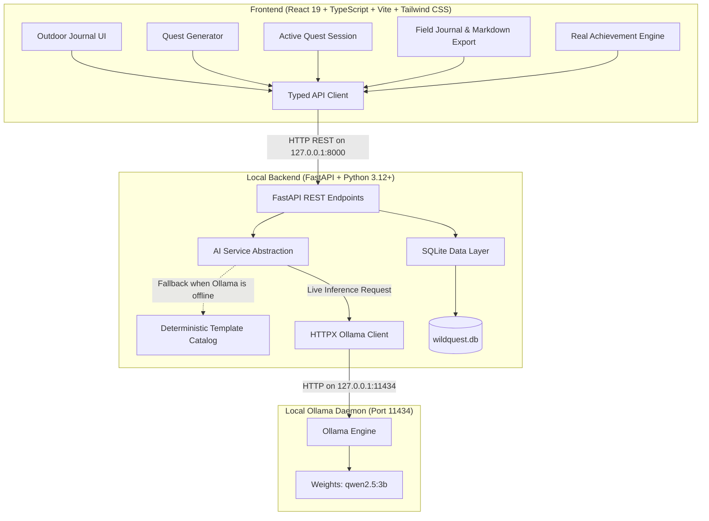

# WildQuest AI 🌿
> **“Less scrolling. More discovering.”**  
> *A privacy-first, local-first nature exploration companion powered by open-weight AI.*  
> *Built for Hacktoberfest 2026.*

[](LICENSE)
[](https://hacktoberfest.com/)
[-blue.svg)](https://ollama.ai)
[](https://fastapi.tiangolo.com)
[](https://react.dev)
[](docs/privacy.md)

---

## 🧭 Project Overview

**WildQuest AI** helps students, software developers, remote workers, and screen-heavy individuals reconnect with the living world through short, achievable, mindful outdoor exploration missions.

Users select their environment (park, garden, campus, forest trail, neighborhood), available time (10, 20, or 30 minutes), and sensory interests (plants, birds, textures, sounds, weather). The application generates customized micro-missions, guides an active outdoor session, records field observations, and synthesizes a reflective nature journal.

### Core Philosophy & Guarantees
- 🔒 **100% Local-First & Privacy-Preserving**: AI inference executes locally via [Ollama](https://ollama.ai) (default: `qwen2.5:3b`). All journal entries and sessions persist exclusively in a local SQLite database (`wildquest.db`).
- ☁️ **Zero Cloud Leakage**: No external cloud AI API keys, remote analytics, tracking pixels, or telemetry.
- 📴 **Offline Deterministic Fallback**: If Ollama is offline or unavailable, the system transparently utilizes a rich deterministic nature catalog. Quests are explicitly badged as local AI vs. offline template.
- 🚫 **No False Identification**: The app never hallucinates species identifications and never invents observations that the user didn't make.
- 🪶 **No Guilt Mechanics**: Zero manipulative daily streak counters or anxiety-inducing notification loops.

---

## 🏛️ System Architecture



---

## 📸 Interface Preview

> *Visual placeholders until screenshots are captured during runtime:*

| View | Description | Preview Placeholder |
| :--- | :--- | :--- |
| **Landing Dashboard** | Hero invitation, live statistics, local AI pill indicator, and recent reflections | `[Screenshot Placeholder: Dashboard Hero & Today's Invitation]` |
| **Quest Generator** | Environment cards, time pills (10/20/30m), multi-interest selector, and AI quest cards | `[Screenshot Placeholder: Personalized Quest Generator Form]` |
| **Active Session** | Live timer, step-by-step mission checklist, and instant field observation notes | `[Screenshot Placeholder: Active Outdoor Exploration Session]` |
| **Field Journal** | Grounded reflection narrative, 3 key takeaways, Markdown download, and full JSON backup | `[Screenshot Placeholder: AI Nature Journal & History]` |
| **Badges & Stats** | Milestone progress (First Steps, Curious Observer, Canopy Whisperer) | `[Screenshot Placeholder: Honest Milestone Achievements]` |

---

## 🛠️ Technology Stack

### Frontend
- **Framework**: React 19 + TypeScript
- **Bundler**: Vite
- **Styling**: Tailwind CSS (Tailored forest green `#1B3B2B`, sage `#8DA382`, cream `#FBF9F4`, and earth tones)
- **Icons**: Lucide React
- **Design Tokens**: Accessible contrast, visible focus rings, subtle parchment textures

### Backend
- **Framework**: FastAPI (Python 3.12+ / Python 3.14 compatible)
- **Validation**: Pydantic v2
- **Networking**: HTTPX (async communication with Ollama)
- **Database**: SQLite with parameterized queries, indexes, and automatic table creation
- **Testing**: Pytest & FastAPI TestClient

### AI Engine
- **Inference Server**: Ollama running locally on `http://127.0.0.1:11434`
- **Default Model**: `qwen2.5:3b` (configurable via `OLLAMA_MODEL` environment variable)
- **Offline Fallback**: Curated deterministic nature exploration template catalog

---

## ⚡ Prerequisites

1. **Python 3.12+** (tested on Python 3.14)
2. **Node.js 20+** (tested on Node.js 24)
3. **Ollama** (optional, recommended for generative quests): [Download Ollama](https://ollama.ai)

---

## 🚀 Step-by-Step Installation

### 1. Clone the Repository
```bash
git clone https://github.com/your-username/WildQuestAI.git
cd WildQuestAI
```

### 2. Set Up Local AI Model (Optional but Recommended)
Open a terminal and pull the default lightweight open-weight model:
```bash
ollama pull qwen2.5:3b
```
*Note: If you skip this step, WildQuest AI automatically runs in its rich deterministic offline template mode.*

---

### 3. Backend Setup

#### Windows PowerShell:
```powershell
cd backend
python -m venv .venv
.\.venv\Scripts\Activate.ps1
pip install -r requirements.txt -r requirements-dev.txt
```

#### Linux / macOS:
```bash
cd backend
python3 -m venv .venv
source .venv/bin/activate
pip install -r requirements.txt -r requirements-dev.txt
```

---

### 4. Frontend Setup

In a new terminal:
```bash
cd frontend
npm install
```

---

## 🏃 Running the Application

### 1. Launch the Backend
From the `backend` folder (with virtual environment activated):
```bash
uvicorn app.main:app --reload --port 8000
```
- API will be accessible at: `http://127.0.0.1:8000`
- Interactive Swagger docs: `http://127.0.0.1:8000/docs`

### 2. Launch the Frontend
From the `frontend` folder:
```bash
npm run dev
```
- Open your browser at: `http://localhost:5173`

---

## 🧪 Running Automated Tests

### Backend Unit & Integration Tests (14 Automated Tests)
From the root directory or inside `backend/`:
```bash
# Windows:
backend\.venv\Scripts\pytest backend\tests -v

# Linux/macOS:
pytest tests -v
```

All 14 tests execute with external Ollama HTTP calls mocked, verifying:
- `/api/health` and `/api/ai/status`
- Quest generation duration constraints and Pydantic input validation
- Deterministic template fallback activation
- Session creation, progress patching, and quest completion
- Journal creation, keyword search, and JSON export
- Ollama timeout, connection error, and malformed response recovery

### Frontend Build & Typecheck
```bash
cd frontend
npm run build
```

---

## 📡 REST API Reference

| Method | Endpoint | Description |
| :--- | :--- | :--- |
| `GET` | `/api/health` | Service health status and privacy assurance |
| `GET` | `/api/ai/status` | Live connectivity check for Ollama and model readiness |
| `GET` | `/api/quests/categories` | Available nature environments, interests, and duration options |
| `POST` | `/api/quests/generate` | Generates 3–5 exploration missions tailored to constraints |
| `POST` | `/api/sessions` | Creates and persists a new quest session in SQLite |
| `GET` | `/api/sessions` | Lists all sessions in chronological order |
| `GET` | `/api/sessions/{session_id}` | Retrieves detailed session record with quests |
| `PATCH` | `/api/sessions/{session_id}` | Updates quest statuses (`completed`/`skipped`) and observation notes |
| `POST` | `/api/journal` | Synthesizes field observations into a grounded reflective journal entry |
| `GET` | `/api/journal` | Lists journal entries with optional `?search=` query and stats |
| `GET` | `/api/journal/{entry_id}` | Retrieves an individual journal entry |
| `DELETE` | `/api/journal/{entry_id}` | Permanently deletes a journal entry |
| `GET` | `/api/journal/export/json` | Exports complete journal backup as a JSON download |

---

## ⚙️ Environment Configuration

Copy `.env.example` to `.env` to customize settings:

```ini
# Backend
HOST=127.0.0.1
PORT=8000
CORS_ORIGINS=http://localhost:5173,http://127.0.0.1:5173
DATABASE_PATH=wildquest.db

# Ollama AI
OLLAMA_BASE_URL=http://localhost:11434
OLLAMA_MODEL=qwen2.5:3b
OLLAMA_TIMEOUT_SECONDS=25
OLLAMA_MAX_RETRIES=2

# Frontend
VITE_API_BASE_URL=http://localhost:8000/api
```

---

## 🔧 Troubleshooting

| Symptom | Cause | Solution |
| :--- | :--- | :--- |
| **"Offline Template Mode" badge** | Ollama is not running or model not pulled | Run `ollama serve` in a terminal and `ollama pull qwen2.5:3b`. WildQuest AI works seamlessly in offline mode regardless! |
| **PowerShell script execution disabled** | Windows Execution Policy prevents `.ps1` | Use `npm.cmd` instead of `npm`, or run `Set-ExecutionPolicy -Scope CurrentUser -ExecutionPolicy RemoteSigned`. |
| **CORS error in browser console** | Backend port differs from `5173` | Ensure `CORS_ORIGINS` in `.env` includes your frontend URL. |
| **Port 8000 already in use** | Another process is listening on 8000 | Run uvicorn on another port: `uvicorn app.main:app --port 8001` and set `VITE_API_BASE_URL=http://localhost:8001/api`. |

---

## 🌿 Limitations & Disclaimers

1. **Not a Taxonomic Identifier**: WildQuest AI generates observation prompts. It is *not* a species classification tool and should never be used to identify edible plants, wild mushrooms, or dangerous wildlife.
2. **Local Hardware Requirements**: Running `qwen2.5:3b` requires approximately 3–4 GB of free RAM. If your device has limited memory, the deterministic offline template mode provides instant, zero-RAM quest generation.

---

## 🤝 Contributing

Contributions are welcome! Please read [CONTRIBUTING.md](CONTRIBUTING.md) for pull request guidelines, Hacktoberfest rules, and code standards.

---

## 📄 License

- Application code is licensed under the **[MIT License](LICENSE)**.
- Third-party models run via Ollama (e.g. Qwen 2.5) are subject to their respective open-weight licenses (Apache 2.0 / Qwen Community License).
